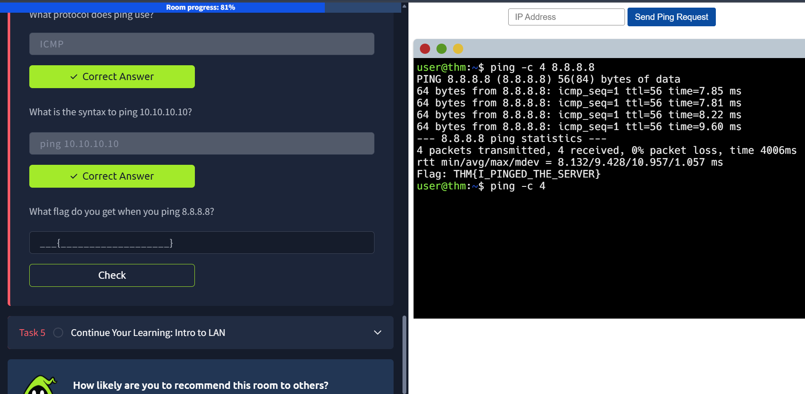

# What is Networking?

**Platform:** TryHackMe 

**Date:** 2026-07-04

**Difficulty:** Easy 

---

## Objective

To understand and learn fundamentals of Networking

---

## Important Commands

- ping: used to send packets to target ip to understand connection performance and reliability

---

## Key Takeaways

- Network is a system of devices connected together.
- There are 2 types of network public & private
- World Wide Web was introduced by Tim Berners-lee
- Devices on IP networks use IP addresses for network communication; an address is not always permanently unique to one device (Internet Protocol address) to identify devices
- IPv4 addresses have 4 octects denoted like this 192.168.10.14 (where these numbers range from 0-255 for all octets)
- IPv6 addresses are longer ip needed for large number of ip generation
- MAC addresses are known as Media Access Control, these addresses are physical network interface level.
- MAC addresses identify network interfaces at the link layer; they may be assigned by manufacturers and can often be changed or randomized
- ICMP is the Internet Control Message Protocol, it is used by the ping command to send packets to desired ip to establish and test connection performance

---

## Challenges Faced

None

---

## Time Taken

20 mins

---

> **Scope:** Notes from authorized TryHackMe training rooms. These notes summarize learning and example commands; they are not independent vulnerability disclosures or proof of exploitation.

## Original Lab Screenshots

